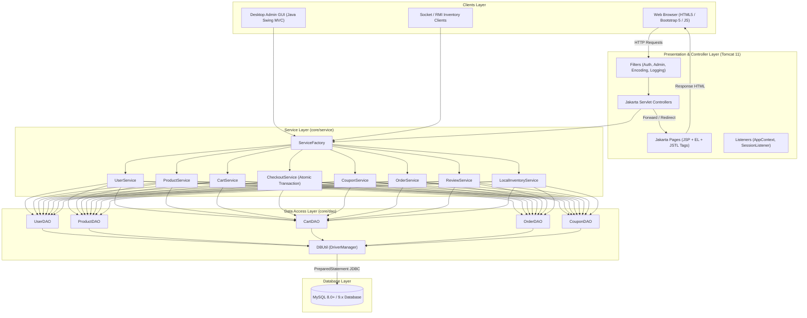
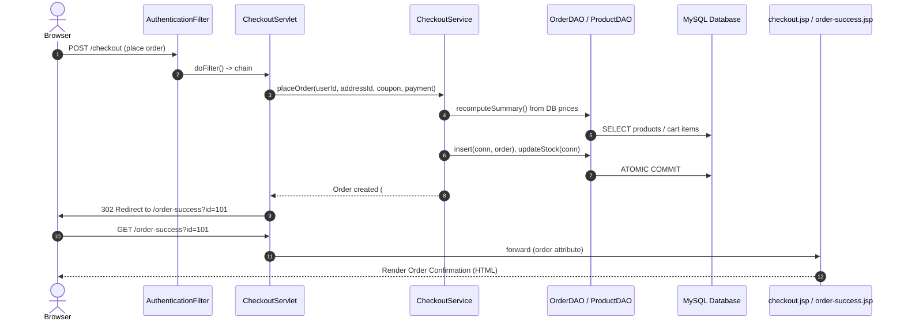
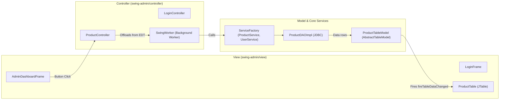

# ShopSphere — N-Tier Architecture & System Flow

## 1. Overall System Architecture

ShopSphere adheres to a pure **N-Tier Enterprise Architecture** separating presentation, control, domain logic, and data persistence without framework lock-in.



---

## 2. Web Request Flow (N-Tier Pipeline)

The strict web lifecycle follows:

```
Browser  ───▶  Servlet Filter (Auth / Logging / Encoding)
                      │
                      ▼
               Servlet Controller (doGet / doPost)
                      │ (Extracts input, validates format)
                      ▼
               Service Layer (Business rules, stock, totals)
                      │
                      ▼
               DAO Layer (PreparedStatement only)
                      │
                      ▼
               MySQL Database (Atomic Commit / Rollback)
                      │
       (Returns Domain Model / DTO to Controller)
                      ▼
   Servlet sets request / session attributes
   Follows Post-Redirect-Get (PRG) for state-changing forms
   Forwards (RequestDispatcher.forward) to JSP
                      ▼
   JSP renders response via EL and JSTL (Zero Java code <% %>)
                      ▼
                 HTML Browser
```



---

## 3. Swing Desktop Admin MVC Pattern

The desktop administration tool mirrors the same N-Tier boundaries:



- **EDT Safety:** Any network or database call runs on a separate worker thread (`SwingWorker`).
- **Separation:** Views contain zero SQL or JDBC calls; controllers interact only with `core` services.
