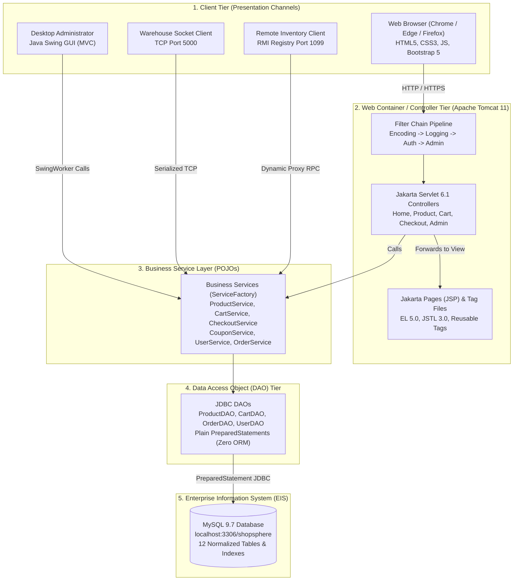
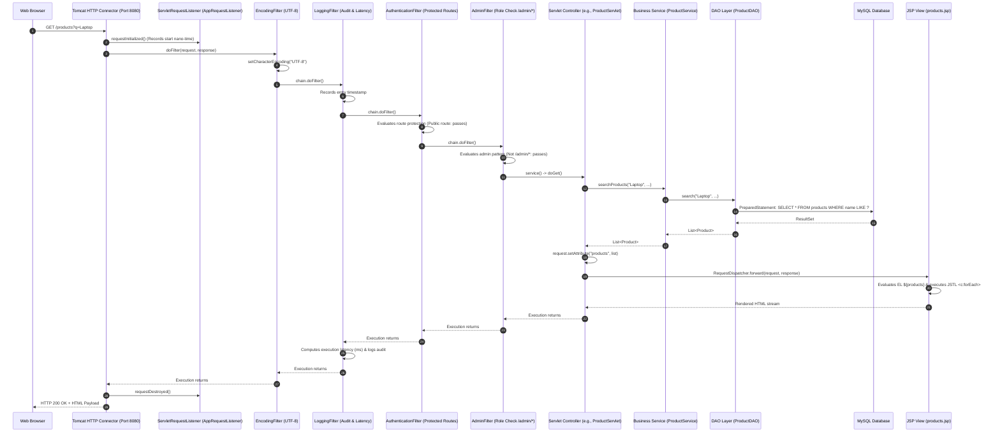

# ShopSphere — Jakarta EE & N-Tier Architecture Reference (`docs/J2EE_NTIER.md`)

This document details the multi-tier enterprise architecture of **ShopSphere**, illustrating how Jakarta EE specifications, Apache Tomcat 11 web container mechanisms, and the HTTP request-response cycle are mapped across software layers.

---

## 1. Multi-Tier Enterprise Architecture (N-Tier)

ShopSphere follows a clean 5-tier architecture separating concerns between user presentation, request routing, business logic, persistence, and physical data storage:

---

## 2. Web Container Request-Response Pipeline (Apache Tomcat 11)

When an HTTP request arrives at Apache Tomcat 11, it is processed through a deterministic lifecycle pipeline before returning an HTTP response to the client:

---

## 3. Layer Separation of Concerns

To guarantee maintainability, testability, and adherence to RTU best practices, strict layer boundaries are enforced:

### A. Presentation Tier (JSP + HTML5 + CSS3 + Bootstrap 5)
- **Rule:** **Zero business logic and zero raw JDBC code in JSPs.**
- JSPs only read model data from request/session attributes using Expression Language (`${...}`) and render UI components using JSTL and Tag Files.
- Dynamic layout assembled via fragments (`header.jsp`, `navbar.jsp`, `footer.jsp`).

### B. Controller Tier (Jakarta Servlets)
- Extends `HttpServlet`.
- **Responsibilities:**
  1. Parses and sanitizes HTTP request parameters (`getParameter()`).
  2. Enforces session state and authentication headers.
  3. Delegates business operations to the Service layer (`ServiceFactory`).
  4. Stores result domain models in `HttpServletRequest` attributes (`setAttribute()`).
  5. Selects view and routes via `RequestDispatcher.forward()` (or `response.sendRedirect()` for Post/Redirect/Get).

### C. Service Tier (Business POJOs)
- Completely independent of web container classes (`HttpServletRequest`, `HttpSession`, etc.).
- Reusable across **Web Servlets**, **Swing Desktop Admin**, **TCP Socket Server**, and **RMI Distributed Service**.
- **Responsibilities:**
  1. Enforces domain invariants (stock validation, coupon calculation, password hashing).
  2. Orchestrates database transactions (`Connection.setAutoCommit(false)` with rollback on failure).

### D. Data Access Object (DAO) Tier
- Interacts directly with MySQL via JDBC.
- Always uses `try-with-resources` for `Connection`, `PreparedStatement`, and `ResultSet`.
- 100% parameterization with positional placeholders (`?`) eliminates SQL injection risks.

---

## 4. Key Viva Questions & Answers

1. **Why is N-tier architecture superior to traditional 2-tier (Client-Server) architecture?**
   - In 2-tier architecture, client machines connect directly to the database and embed business logic. This makes updates difficult, couples business logic to database schema, and poses security vulnerabilities. In N-tier architecture, business logic is centralized in the service tier, database credentials never leave the server, and clients (web, desktop, sockets) can be updated or replaced independently.
2. **What is the difference between `RequestDispatcher.forward()` and `HttpServletResponse.sendRedirect()`?**
   - `forward()` is a **server-side** internal dispatch: the browser's address bar does not change, request attributes are preserved, and only one HTTP request occurs.
   - `sendRedirect()` is a **client-side** operation: the server sends an HTTP 302 redirect response with a `Location` header, the browser issues a completely new HTTP GET request, and previous request attributes are discarded. Used in the Post/Redirect/Get pattern to prevent duplicate form submissions.
3. **What is the difference between `<%@ include file="..." %>` and `<jsp:include page="..." />`?**
   - The `<%@ include %>` directive is **static (translation-time)**: the target file's raw content is merged into the host page before Java source compilation. Changes in the included file do not reflect until the parent page is recompiled.
   - The `<jsp:include>` action is **dynamic (request-time)**: the target page is executed as an independent servlet, and its runtime output is flushed into the response. Can take runtime parameters via `<jsp:param>`.
