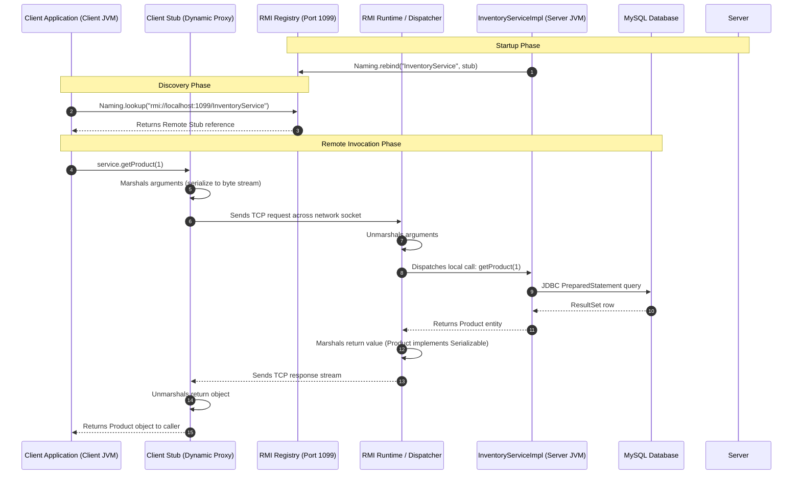

# ShopSphere — Java Remote Method Invocation (RMI) Subsystem (`rmi`)

This document details the **Java Remote Method Invocation (RMI)** architecture of ShopSphere, covering the RTU Advanced Java syllabus: `java.rmi.*`, RMI Registry (`rmiregistry` / `LocateRegistry`), client stubs, server dispatchers, object serialization/marshaling, and dynamic proxy generation.

---

## 1. RMI Architecture Overview

Java RMI enables an object running in one Java Virtual Machine (Client JVM) to invoke methods on an object residing in another JVM (Server JVM) over TCP/IP as if it were a local method call.



---

## 2. Key Components Explained

### A. Remote Interface (`InventoryService`)
- Extends `java.rmi.Remote` (marker interface).
- All remote method signatures must declare `throws java.rmi.RemoteException`.
- Arguments and return types must be primitives or implement `java.io.Serializable` (e.g. `Product`).

### B. Remote Object Implementation (`InventoryServiceImpl`)
- Extends `java.rmi.server.UnicastRemoteObject`.
- Calling `super()` in constructor exports the remote object to listen on an anonymous ephemeral TCP port for incoming client method requests.
- Implements the business logic by delegating to `LocalInventoryService` and MySQL JDBC DAO layer.

### C. RMI Registry (`LocateRegistry` / `rmiregistry`)
- A naming directory mapping human-readable string names (`"InventoryService"`) to remote object references (stubs).
- Started programmatically via `LocateRegistry.createRegistry(1099)` or externally using the JDK `rmiregistry` tool.
- Bound using `Naming.rebind("rmi://localhost:1099/InventoryService", impl)`.

### D. Client Stub (Dynamic Proxy vs Legacy `rmic`)
- In Java 1.1–1.4, developers had to run the `rmic` compiler to produce `_Stub.class` and `_Skel.class` files.
- **Modern Java (Java 5+)**: The JVM generates stubs dynamically at runtime using Java dynamic reflection proxies (`java.lang.reflect.Proxy`). Pre-compiled skeletons have been replaced by a direct reflection dispatcher in the RMI runtime.

### E. Marshaling & Unmarshaling
- **Marshaling**: Serializing method names, parameter types, and object values into a portable byte stream.
- **Unmarshaling**: Reconstructing method invocations and deserializing object payloads in the receiving JVM.

---

## 3. How to Run RMI Server and Client

### Option A: Automated Scripted Execution via Maven
Run the RMI Server:
```powershell
mvn exec:java -pl rmi -Dexec.mainClass="com.shopsphere.rmi.RmiServer"
```
Console output:
```
==========================================================================
        SHOPSPHERE — RTU ADVANCED JAVA SYLLABUS: RMI SERVER               
==========================================================================
[RMI Server] Creating in-process RMI Registry on port 1099...
  >>> RMI Registry successfully started on port 1099
[RMI Server] Instantiating InventoryServiceImpl (UnicastRemoteObject)...
[RMI Server] Registering service stub with naming directory: rmi://localhost:1099/InventoryService

==========================================================================
  RMI Server Status: ACTIVE & LISTENING                                   
  Service Name:      InventoryService
  Lookup URL:        rmi://localhost:1099/InventoryService
  Underlying DB:     MySQL localhost:3306/shopsphere
==========================================================================
```

In a separate terminal, run the RMI Client:
```powershell
mvn exec:java -pl rmi -Dexec.mainClass="com.shopsphere.rmi.RmiClient"
```
The client connects, performs lookup, and invokes `getProduct(1)`, `getStock(1)`, `updateStock()`, and `getLowStockProducts()` over RMI.

### Option B: Interactive CLI Client
```powershell
mvn exec:java -pl rmi -Dexec.mainClass="com.shopsphere.rmi.RmiClient" -Dexec.args="--interactive"
```

---

## 4. Key Viva Questions & Answers

1. **What is the difference between Sockets and RMI?**
   - **Sockets** provide low-level byte-oriented communication where the developer must design and parse custom message protocols.
   - **RMI** provides high-level object-oriented procedure abstraction where remote methods appear as standard Java method calls with automatic parameter marshaling.
2. **Why must remote methods throw `RemoteException`?**
   - Distributed communication can fail due to network disconnection, packet loss, server crash, or marshaling failure. `RemoteException` is a checked exception compelling the developer to handle distributed failures.
3. **What is the role of `UnicastRemoteObject`?**
   - It exports the remote object, making it available to receive incoming remote calls using TCP sockets on a listening port.
4. **Is `rmic` still required in Java 17 / 21?**
   - No. Since Java 5.0, standard RMI generates dynamic client stubs automatically at runtime.
