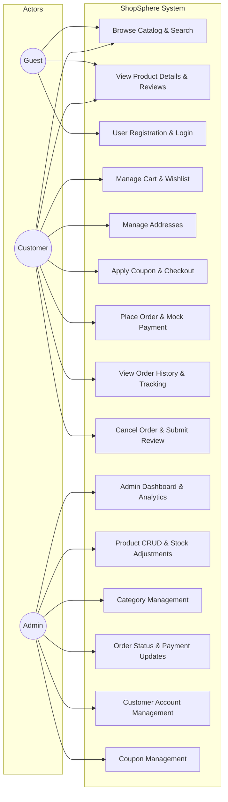

# ShopSphere — Use Cases & Actor Specifications

## 1. Primary Actors
1. **Guest (Unauthenticated User):** An anonymous visitor browsing the online catalog, viewing product details, and initiating account creation or sign-in.
2. **Customer (Authenticated User):** A registered consumer who can manage their profile, cart, wishlist, saved addresses, apply coupons, place orders, track shipments, and review purchased products.
3. **Administrator:** A privileged manager who oversees the store catalog, orders, categories, customer accounts, coupon rules, and system inventory (via web dashboard and Swing desktop client).

---

## 2. Use Case Diagram

---

## 3. Use Case Specifications Table

| Use Case ID | Use Case Name | Primary Actor | Preconditions | Main Success Scenario |
|---|---|---|---|---|
| **UC-01** | Browse & Search Products | Guest, Customer | None | User enters keywords, selects categories, price range, and sorting. System returns paginated products. |
| **UC-02** | View Product Details | Guest, Customer | Product exists | User views full specs, stock status, average rating, customer reviews, and related products. |
| **UC-03** | Register Account | Guest | Email is unique | User submits registration form; system validates input, hashes password, saves record, and logs in user. |
| **UC-04** | User Login | Guest | Valid credentials | User submits email and password; system validates hash, creates session, and redirects based on role. |
| **UC-05** | Add to Cart | Customer | Product in stock | User specifies quantity; system checks current stock and adds/updates cart item in database. |
| **UC-06** | Manage Wishlist | Customer | Logged in | User saves items for later; can move items directly to shopping cart. |
| **UC-07** | Apply Coupon | Customer | Active coupon | User inputs promo code; system verifies expiry, min order value, usage limit, and computes discount. |
| **UC-08** | Checkout & Place Order | Customer | Cart not empty | User selects shipping address, payment method, reviews calculated totals, and confirms order. Transaction commits atomically. |
| **UC-09** | Track Order & History | Customer | Logged in | Customer views past orders with visual timeline (Placed $\to$ Confirmed $\to$ Shipped $\to$ Delivered). |
| **UC-10** | Cancel Order | Customer | Status allows cancel | Customer cancels pending order; system updates status to CANCELLED and restores product stock. |
| **UC-11** | Submit Product Review | Customer | Purchased item | Customer rates (1-5 stars) and writes feedback; system records review and updates product average rating. |
| **UC-12** | Admin Dashboard Analytics | Admin | Admin role | Admin views real-time metrics: sales total, active sessions, low stock warnings, and recent orders. |
| **UC-13** | Manage Products | Admin | Admin role | Admin performs CRUD operations on products and adjusts inventory stock levels. |
| **UC-14** | Manage Categories | Admin | Admin role | Admin creates, edits, and organizes category tree. |
| **UC-15** | Update Order Lifecycle | Admin | Admin role | Admin updates order status (e.g., to SHIPPED or DELIVERED) and payment status. |
| **UC-16** | Manage Customers | Admin | Admin role | Admin views customer list, registration dates, and can deactivate suspicious accounts. |
| **UC-17** | Manage Coupons | Admin | Admin role | Admin configures discount coupons (percentage/flat, limits, validity window). |
