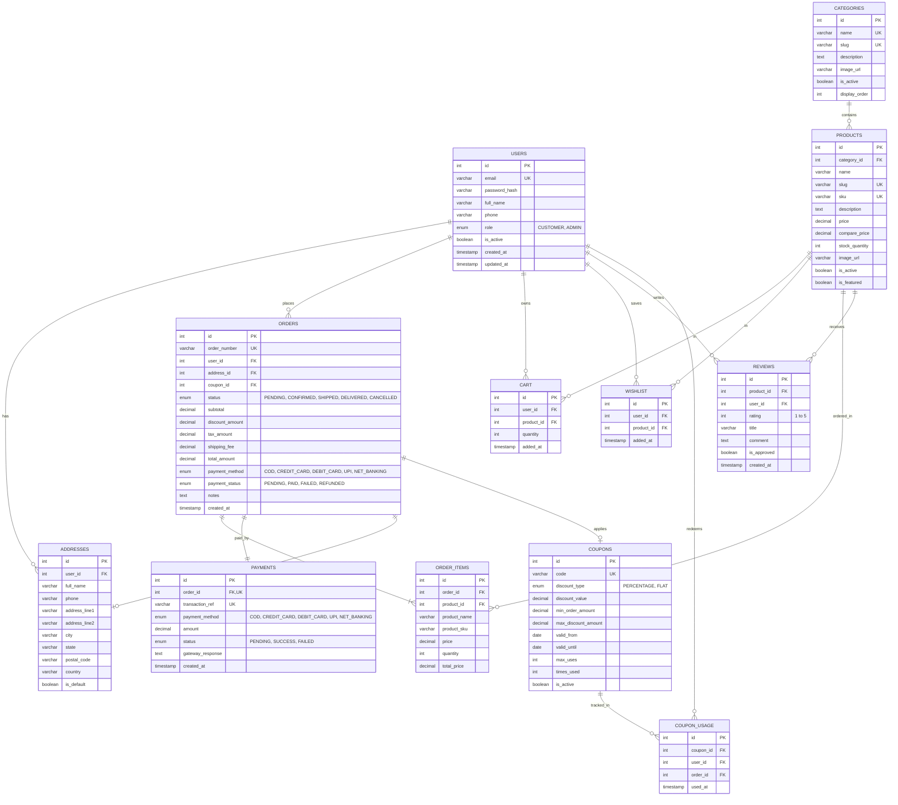

# ShopSphere — Entity Relationship (ER) Diagram

This diagram visualizes the relational schema of **ShopSphere** (12 tables), showing primary keys, foreign keys, constraints, and cardinalities in third normal form (3NF).

