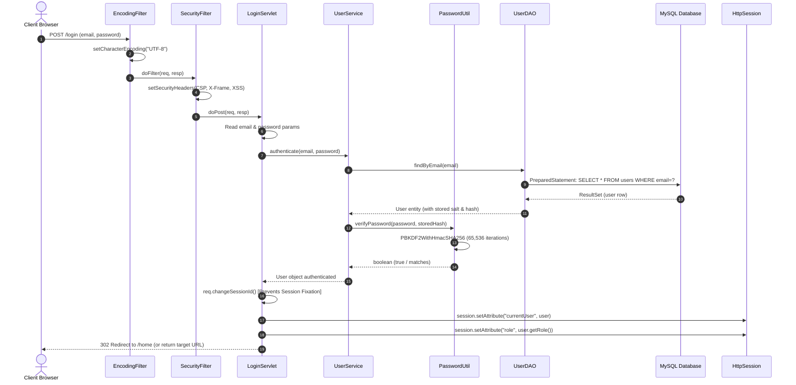

# ShopSphere — Authentication & Login Sequence Diagram

This sequence diagram depicts the end-to-end execution flow of user authentication, including HTTP interceptor filters, PBKDF2 credential verification, and session fixation defense.

