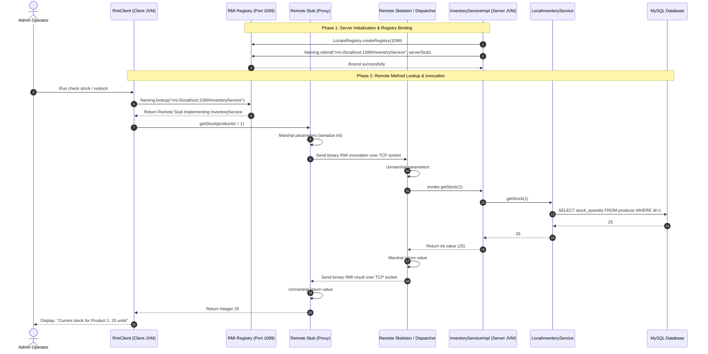

# ShopSphere — Java RMI Distributed Architecture Sequence Diagram

This sequence diagram depicts the distributed object interaction in **ShopSphere** using Java Remote Method Invocation (RMI), showing registry binding, stub generation, parameter serialization, and remote execution across separate JVMs.

