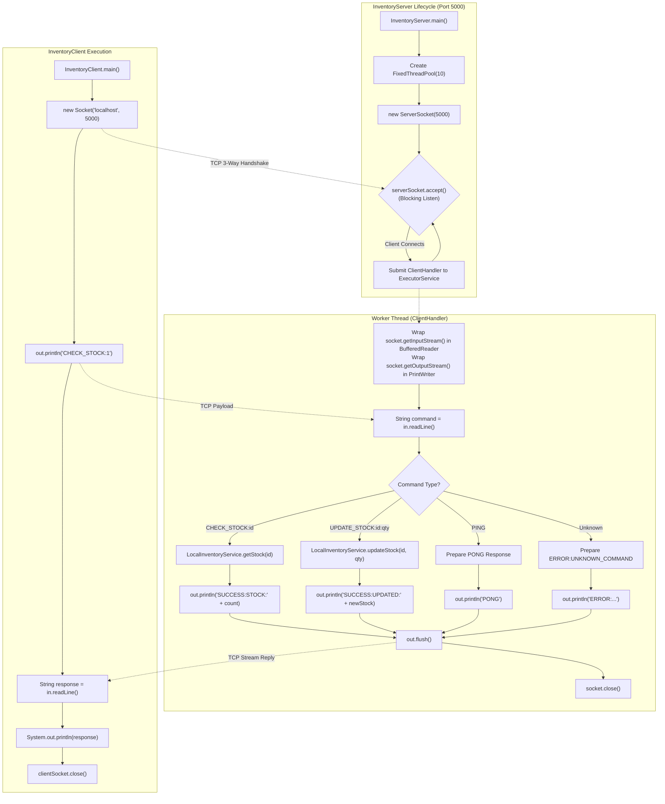

# ShopSphere — Multithreaded TCP Socket Flow Diagram

This diagram visualizes the low-level network programming flow in `shopsphere-network`, showing `ServerSocket` connection acceptance, thread-pool worker dispatch, stream encapsulation, and protocol command processing over TCP port 5000.

