# ShopSphere — Use Case Diagram

This diagram visualizes the primary system actors (**Guest Visitor**, **Authenticated Customer**, **System Administrator**) and their interaction boundaries with the **ShopSphere** system.

```mermaid
flowchart LR
    %% Actors
    Guest(("Guest Visitor"))
    Customer(("Customer"))
    Admin(("Administrator"))

    %% Subsystem Boundary
    subgraph ShopSphere["ShopSphere E-Commerce System"]
        %% Guest Use Cases
        UC_Browse["Browse Catalog & Categories"]
        UC_Search["Search & Filter Products"]
        UC_ViewDetail["View Product Details & Reviews"]
        UC_Register["Register Account"]
        UC_Login["Login to System"]
        UC_Lang["Switch Language (EN / HI)"]

        %% Customer Use Cases
        UC_ManageCart["Manage Shopping Cart"]
        UC_ManageWishlist["Manage Wishlist"]
        UC_ApplyCoupon["Apply Promotional Coupon"]
        UC_Checkout["Atomic Checkout & Payment"]
        UC_OrderHistory["View Order History & Tracking"]
        UC_SubmitReview["Write Product Review"]
        UC_ManageProfile["Manage Profile & Addresses"]
        UC_Logout["Logout"]

        %% Admin Use Cases
        UC_AdminDash["View Analytics & Dashboard"]
        UC_ManageProducts["Manage Products (CRUD)"]
        UC_ManageCategories["Manage Categories (CRUD)"]
        UC_ManageOrders["Update Order Statuses"]
        UC_ManageCustomers["Activate / Deactivate Users"]
        UC_ManageCoupons["Manage Coupons & Discounts"]
        UC_WarehouseSync["Inventory Restock (Swing / Socket / RMI)"]
    end

    %% Guest Relationships
    Guest --> UC_Browse
    Guest --> UC_Search
    Guest --> UC_ViewDetail
    Guest --> UC_Register
    Guest --> UC_Login
    Guest --> UC_Lang

    %% Customer Relationships
    Customer --> UC_Browse
    Customer --> UC_Search
    Customer --> UC_ManageCart
    Customer --> UC_ManageWishlist
    Customer --> UC_ApplyCoupon
    Customer --> UC_Checkout
    Customer --> UC_OrderHistory
    Customer --> UC_SubmitReview
    Customer --> UC_ManageProfile
    Customer --> UC_Logout

    %% Admin Relationships
    Admin --> UC_Login
    Admin --> UC_AdminDash
    Admin --> UC_ManageProducts
    Admin --> UC_ManageCategories
    Admin --> UC_ManageOrders
    Admin --> UC_ManageCustomers
    Admin --> UC_ManageCoupons
    Admin --> UC_WarehouseSync
```

